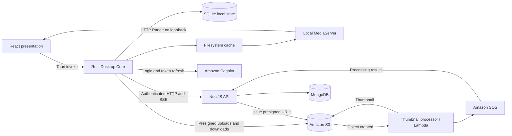

# Bucketnizer

**A desktop-first personal media library with cloud storage, offline browsing, and a persistent upload queue.**

Bucketnizer organizes photos, videos, audio, and other files into folders and subfolders. Originals live in Amazon S3; the desktop keeps a local metadata index, thumbnails, and recently opened originals. The gallery uses thumbnails for browsing and downloads originals on demand.

The workspace contains a React/Tauri desktop application, a NestJS API, and shared technical documentation. It is under active development; some documents describe future features rather than shipped functionality.

## Contents

- [Features](#features)
- [Architecture](#architecture)
- [Repository layout](#repository-layout)
- [Getting started](#getting-started)
- [Data flows](#data-flows)
- [API overview](#api-overview)
- [Development and testing](#development-and-testing)
- [Current limitations](#current-limitations)
- [Troubleshooting](#troubleshooting)
- [Documentation](#documentation)

## Features

- **Personal library:** folders, nested folders, file renaming, previews, and original downloads. Uploads without a destination go to `Recentes`.
- **Authentication:** Cognito managed login, Google federation, Authorization Code + PKCE, and session persistence through the operating system's credential store.
- **Offline browsing:** revisit previously loaded metadata and locally cached thumbnails; open originals already present in the cache.
- **Controlled cache:** a default 10 GB budget for originals, LRU eviction, and protection for active readers and pinned files. Thumbnails have separate retention from that budget.
- **Persistent uploads:** select multiple files without the previous five-file selection limit. Rust stores upload intentions in SQLite, requests at most 20 tickets per batch, and streams at most five S3 PUTs concurrently.
- **Recovery:** per-file errors, retry/backoff, restart recovery, and queued uploads while offline.
- **Local media playback:** a loopback MediaServer provides revocable URLs and HTTP Range support for video/audio seeking.
- **Trash:** restore files during a 30-day retention window, request permanent deletion, and queue lifecycle actions offline.
- **Live updates:** authenticated SSE, native events, reconnection, and state reconciliation.
- **Desktop UI:** light/dark themes, drag and drop, upload progress, and notifications.

File storage is not limited to images. Inline previews depend on file format and installed codecs; thumbnail generation and transition to `READY` also depend on the externally deployed processing pipeline.

## Architecture



| Component | Responsibility |
| --- | --- |
| React + TypeScript | Presentation, user interactions, and visual state through native commands |
| Rust + Tauri 2 | Authentication, HTTP, local persistence, caching, upload/lifecycle queues, and media serving |
| NestJS + TypeScript | Remote authorization, library metadata, upload tickets, processing events, and trash cleanup |
| MongoDB + Mongoose | Authoritative remote library and folder records |
| SQLite | Local library index, cache metadata, persistent upload intentions, and pending trash operations |
| Filesystem cache | Temporary downloaded media bytes |
| Amazon S3 | Permanent original and thumbnail objects |
| Lambda + SQS | External asynchronous thumbnail processing and completion delivery |
| Cognito | User identity, managed login, and tokens |

React does not call the API or S3 directly. HTTP and orchestration live in Rust. SQLite stores metadata and intentions, not large file blobs or presigned URLs. The local cache is not a full S3 mirror.

The Rust core follows the existing Clean Architecture boundaries:

- `domain`: entities, errors, and repository contracts.
- `application`: use cases, cache decisions, upload scheduling, and trash orchestration.
- `data`: repository implementations, DTOs, and local/remote datasources.
- `infra`: HTTP, authentication, SQLite migrations, filesystem, network, events, and MediaServer.
- `presentation`: Tauri commands and events.

## Repository layout

```text
bucketnizer/
├── README.md
├── bucketnizer-api/
│   ├── src/                 # NestJS auth, files, events, SQS, and health modules
│   ├── test/                # Additional integration/e2e test support
│   └── k6/                  # Authenticated load-test journeys
├── bucketnizer-front/
│   └── front/
│       ├── src/
│       │   ├── main.tsx     # React entry point
│       │   ├── app/         # Application composition
│       │   ├── features/    # Authentication and gallery features
│       │   └── shared/      # Shared UI, utilities, and IPC adapter
│       └── src-tauri/
│           └── src/        # Rust Desktop Core
└── docs/                    # Architecture, operating notes, and proposals
```

The API and desktop have independent dependency manifests and lockfiles. There is no root-level install/build script.

## Getting started

### 1. Prerequisites

You need:

- A Node.js version compatible with the checked-in NestJS/Vite dependencies, plus npm and pnpm.
- A current stable Rust toolchain and native build tools for Tauri 2.
- On Linux: WebKitGTK 4.1, GTK development dependencies, a running Secret Service credential store, and GStreamer playback plugins/codecs for the media you want to preview.
- A reachable MongoDB instance.
- An S3 bucket, SQS thumbnail-result queue, and a configured external thumbnail processor.
- A Cognito User Pool and public app client, with Google federation configured if Google login is needed.

The checked-in desktop bundle targets are Linux `.deb` and AppImage. Other platform packaging needs separate configuration and validation.

### 2. Install dependencies

Run from the workspace root:

```bash
pnpm --dir bucketnizer-api install --frozen-lockfile
npm ci --prefix bucketnizer-front/front
```

Cargo resolves the native dependencies when building or starting Tauri.

### 3. Configure the API

Create `bucketnizer-api/.env` locally. Replace the example values with your environment:

```dotenv
MONGO_URI=mongodb://127.0.0.1:27017/bucketnizer
AWS_REGION=sa-east-1
AWS_BUCKET=your-bucket-name
THUMBNAIL_QUEUE_URL=https://sqs.sa-east-1.amazonaws.com/ACCOUNT_ID/QUEUE_NAME
COGNITO_USER_POOL_ID=your-user-pool-id
COGNITO_CLIENT_ID=your-public-app-client-id
PORT=3000
```

| Variable | Purpose |
| --- | --- |
| `MONGO_URI` | Required MongoDB connection string |
| `AWS_REGION` | Region for AWS service clients |
| `AWS_BUCKET` | Bucket containing originals and thumbnails |
| `THUMBNAIL_QUEUE_URL` | Required queue consumed by NestJS; initialization fails if missing |
| `COGNITO_USER_POOL_ID` | Required pool used by the backend JWT verifier |
| `COGNITO_CLIENT_ID` | Required app client used by the backend JWT verifier |
| `PORT` | API listen port; defaults to `3000` |

The AWS SDK uses its standard credential provider chain. Keep credentials outside source control and outside the desktop application. The backend needs access to its bucket operations and to receive/delete messages from the configured queue; the processor needs its own permissions to read originals, write thumbnails, and send completion messages.

Starting the API starts both the SQS consumer and the trash-cleanup worker. Use development resources when running locally: the services act on whichever bucket, queue, and database you configure.

### 4. Align desktop configuration

The desktop API base URL is currently compiled into [`app_state.rs`](bucketnizer-front/front/src-tauri/src/app_state.rs) as `http://127.0.0.1:3000`. Changing the API port or host requires updating this value and rebuilding the native application.

Cognito constants live in [`infra/auth/cognito.rs`](bucketnizer-front/front/src-tauri/src/infra/auth/cognito.rs). Align its client ID, issuer, and login domain with the API environment. The desktop does not read these values from the backend `.env`.

The current login flow uses:

- A public Cognito app client without a client secret.
- Authorization Code + PKCE and the `openid email profile` scopes.
- Callback: `bucketnizer://auth/callback`.
- Logout return: `bucketnizer://auth/logout`.
- The system browser for managed login, followed by a deep link back to the app.

See [Cognito setup](docs/cognito.md) for the current deployment values and federation notes. That document contains historical configuration notes; the backend currently requires both Cognito environment variables explicitly.

To override the original-cache budget, set `BUCKETNIZER_CACHE_BYTES` in the environment that launches Tauri. The default is `10000000000` bytes. This is separate from the API configuration.

### 5. Run locally

Start each process in a separate terminal, from the workspace root:

```bash
# Terminal 1: API
pnpm --dir bucketnizer-api start:dev
```

```bash
# Terminal 2: desktop application (also starts Vite)
npm run tauri --prefix bucketnizer-front/front -- dev
```

The API defaults to port `3000`; Vite uses `127.0.0.1:1420`. Keep the desktop open while completing browser login so the callback can reach it.

For a browser-only UI preview:

```bash
npm run dev --prefix bucketnizer-front/front
```

Authentication, library access, queues, and native notifications require Tauri. The browser preview has no JavaScript HTTP fallback.

## Data flows

### Upload and processing

1. The user selects files or drops them into a destination folder.
2. Rust validates the sources and persists individual upload intentions in SQLite.
3. When the service is reachable, the UploadManager requests tickets for up to 20 files.
4. Up to five workers stream files directly to S3 without loading entire originals into memory.
5. The external processor generates thumbnails and publishes `THUMBNAIL_CREATED` messages to SQS.
6. NestJS updates the corresponding MongoDB record to `READY` and emits `file.ready` over SSE.
7. The desktop reconciles the library and updates the gallery.

A successful S3 PUT and a ready thumbnail are separate stages. The queue persists progress across restarts, isolates failures per file, and obtains fresh tickets when needed. Pending source files must remain at their original local paths.

Storage keys preserve ownership and logical folder hierarchy:

```text
originals/{subject}/{folder/subfolder}/{objectId}
thumbnails/{subject}/{folder/subfolder}/{objectId}.webp
```

Renaming changes the display name, not the S3 key. The external thumbnail processor must support nested paths and publish the message format consumed by [`SqsService`](bucketnizer-api/src/sqs/sqs.service.ts). Its deployment is not managed by these application start commands.

### Preview and offline access

Preview checks the local cache before requesting remote authorization or a presigned URL. A hit can open offline. A miss downloads the original from S3 when available; otherwise the core returns `OFFLINE_FILE_UNAVAILABLE`.

The MediaServer binds to `127.0.0.1` on a dynamic port and serves cache-contained paths through unpredictable, revocable tokens. Video/audio uses HTTP Range requests for seeking. The first original download completes before playback begins.

Online listing updates the SQLite index. On appropriate network failures, the app falls back to previously stored metadata and thumbnails. `SESSION_EXPIRED` is distinct from a network failure. A first login still requires connectivity; reopening offline relies on an identity previously saved with the secure credential.

LRU eviction primarily applies to originals. Active readers and pinned files are protected; missing files and stale cache metadata are reconciled. The pinning mechanism exists in the core, but a complete “keep available offline” UI is not implemented.

### Trash and permanent deletion

Trash is a virtual collection; objects keep their original S3 keys and folder path. A confirmed trash operation changes `READY` to `TRASHED` and starts a **30 × 24-hour** retention window on the backend.

- Restore returns the file to its original folder before the deadline.
- Permanent deletion can be requested earlier with explicit confirmation.
- Offline actions are persisted separately from upload intentions.
- Version checks and stable operation IDs protect against stale actions and duplicate retries.
- The cleanup worker deletes the original and thumbnail before deleting the MongoDB record.
- Partial failures retain recoverable state and retry with backoff.

The restoration deadline is exact; physical deletion is asynchronous. Cleanup runs at backend startup and between periodic sweeps. If the backend is offline, cleanup resumes when it returns. See [Trash lifecycle](docs/lixeira.md) for leases, retries, migrations, and reconciliation.

## API overview

The API uses Cognito access tokens in `Authorization: Bearer <access_token>`. The authenticated `sub` determines ownership; clients do not choose the owner by sending `userId`. The global authentication guard also applies to the health route.

| Method | Route | Purpose |
| --- | --- | --- |
| GET | `/health` | API reachability response; not a full dependency-health check |
| GET | `/events` | User-scoped SSE stream |
| GET / POST | `/files/folders` | List or create folders |
| POST | `/files/upload` | Create/reuse a single upload intention and ticket |
| POST | `/files/uploads` | Batch tickets for 1–20 files, with individual results |
| GET | `/files/thumbnails?path=...` | Ready-file metadata and thumbnail URLs |
| GET | `/files/:objectId/status` | Processing status |
| POST | `/files/statuses` | Reconcile lifecycle states for 1–100 IDs |
| GET | `/files/:objectId` | Obtain a temporary original-download URL |
| PUT | `/files/:objectId/rename` | Update the display name through `newFileName` |
| DELETE | `/files/:objectId` | Move to trash |
| GET | `/files/trash?cursor=...` | Paginated trash listing, up to 50 items |
| POST | `/files/:objectId/restore` | Restore an eligible trashed file |
| DELETE | `/files/:objectId/permanent` | Schedule permanent deletion |

Upload endpoints receive JSON metadata, not media bytes. Trash mutations require `{ operationId, expectedVersion }`. Refer to the [controller](bucketnizer-api/src/files/files.controller.ts), [DTOs](bucketnizer-api/src/files/dto), and [trash service](bucketnizer-api/src/files/trash.service.ts) for current payloads and error behavior.

## Development and testing

Run from the workspace root:

```bash
# API
pnpm --dir bucketnizer-api test
pnpm --dir bucketnizer-api run lint
pnpm --dir bucketnizer-api build

# React: tests and TypeScript/Vite build
npm test --prefix bucketnizer-front/front
npm run build --prefix bucketnizer-front/front

# Desktop Core
cargo fmt --manifest-path bucketnizer-front/front/src-tauri/Cargo.toml --check
cargo check --manifest-path bucketnizer-front/front/src-tauri/Cargo.toml
cargo test --manifest-path bucketnizer-front/front/src-tauri/Cargo.toml

# Native desktop bundle
npm run tauri --prefix bucketnizer-front/front -- build
```

The frontend has no separate lint script; its build runs TypeScript checks. Rust HTTP and MediaServer tests need permission to bind local loopback ports.

Unit tests cover authentication, cache/offline behavior, upload batching and concurrency, persistence/recovery, lifecycle actions, and API contracts with mocks/fakes. They do not prove that a deployed Cognito/S3/Lambda/SQS environment is configured correctly. The API also provides `test:e2e`; review its environment and dependencies before running it.

For load tests, see the [k6 guide](bucketnizer-api/k6/README.md). Upload journeys create persistent objects and downloads generate S3 traffic; these are separate from isolated unit tests.

## Current limitations

- Library listing currently returns the latest **20 READY files** for the requested folder scope. The local index accumulates visited data; it is not a complete remote-library synchronization or a full pagination solution.
- Offline browsing only includes metadata and media already stored locally. Originals are never bulk-downloaded automatically.
- Uploads use streaming single-object PUTs, not multipart/resumable byte-range uploads. Restart recovery does not mean resuming a partially transferred file at its last byte.
- Thumbnail generation for every possible file type is not guaranteed by this repository. The external processor determines supported formats and successful completion.
- Trash cleanup and SQS consumption require a running backend. Physical deletion cannot be guaranteed at an exact wall-clock instant during an outage.
- SSE delivery is process-local; it is not a durable cross-instance event bus. Reconciliation handles missed updates.
- The desktop API and Cognito settings are currently compiled into Rust rather than exposed through a configuration UI.
- Shared sessions, mobile/QR imports, Google Drive, and Dropbox imports are future work, not available integrations.

## Troubleshooting

| Symptom | Check |
| --- | --- |
| API fails at startup | Required environment variables, MongoDB reachability, and Cognito configuration |
| Upload remains in processing | Lambda execution, thumbnail output, SQS queue/permissions, consumer logs, and matching object/user IDs |
| Cached gallery works but remote actions fail | API availability, native API base URL, session validity, and cloud credentials |
| Login callback does not return to the app | Cognito callback allowlist, matching client configuration, `bucketnizer://` registration, and running desktop process |
| Secure storage error | An available/unlocked operating-system credential store; do not replace it with plaintext token storage |
| MP4/audio fails on Linux or `autoaudiosink` is missing | Installed GStreamer audio sinks and codecs; an `.mp4` extension alone does not guarantee codec support |
| “File unavailable offline” | The original has not been cached, was evicted, or is no longer available locally |
| Fewer files appear than exist in S3 | Current 20-item listing limit, folder scope, MongoDB records, and `READY` status; S3 objects alone do not populate the gallery |
| Cargo reports plugin paths from an old project location | Clean native build artifacts with the command below, then rebuild |

```bash
cargo clean --manifest-path bucketnizer-front/front/src-tauri/Cargo.toml
```

## Documentation

Most detailed documents are currently written in Portuguese. Start with the implementation guides; treat historical designs and proposals as context rather than current API contracts.

| Document | Scope |
| --- | --- |
| [Desktop Core](docs/desktop-core.md) | Offline index, cache/LRU, uploads, persistence, and operational limitations |
| [Native architecture](docs/tauri-architecture.md) | Layer boundaries, Tauri commands, and events |
| [Cognito](docs/cognito.md) | Login, deep links, secure storage, and account isolation |
| [Trash](docs/lixeira.md) | Retention, restore, permanent cleanup, and offline mutations |
| [Rust migration and multiple uploads](docs/migracao-rust-e-upload-multiplo.md) | Migration background and native upload flow |
| [k6 load testing](bucketnizer-api/k6/README.md) | Test journeys, configuration, and workload effects |
| [Shared sessions](docs/sessoes-compartilhadas.md) | Planned collaboration model; not implemented |
| [Mobile upload via QR](docs/upload-celular-qr.md) | Planned temporary upload authorization; not implemented |
| [Original project overview](docs/01-projeto-atual.md) | Historical architecture snapshot |
| [Use cases](docs/02-casos-de-uso.md) | Historical/current-at-writing diagrams and proposed flows |
| [Original upload flow](docs/03-fluxo-upload-atual.md) | Historical upload description |
| [V2 proposal](docs/04-v2-upload-direto-s3.md) | Proposed contracts; do not assume `/v2` routes exist |
| [UI design notes](docs/design/redesign.md) | Visual direction and interface design context |

## License

No open-source license is declared at the workspace root. The backend package is marked `UNLICENSED`; do not assume permission to redistribute it under an open-source license.
